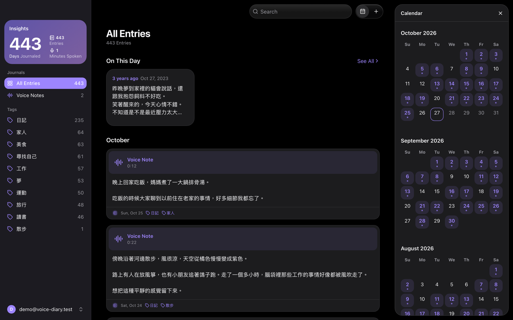
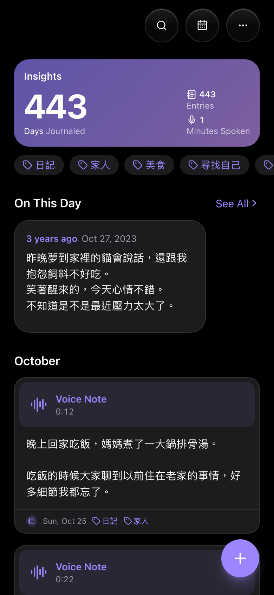

# Voice Diary

A self-hosted diary. Write each entry as text, record voice notes, or do both; every voice note is transcribed to text automatically.

You run it on your own accounts: the app on your Cloudflare Worker, entries in your Supabase database, audio in your R2 bucket. No one else hosts your diary, and only the emails you list can sign in. The one outside service is OpenAI, which receives each voice note to transcribe it.

  
  &nbsp;&nbsp;
  

- **TanStack Start** (file routes in `src/routes`, server functions in `src/server`, a session middleware in `src/start.ts`) with TanStack Query for the pages' data, built by Vite and run as a Cloudflare Worker
- **Supabase**: Google sign-in plus Postgres, with row-level security so each user sees only their own entries
- **Cloudflare R2**: audio files, uploaded straight from the browser through presigned URLs
- **OpenAI `gpt-transcribe`**: speech-to-text

## Host your own

1. Create a Supabase project, an R2 bucket, an OpenAI API key and a Google OAuth client.
2. Add your email to the sign-in lists.
3. Store the values from `.env.example` as Worker secrets and run `pnpm run deploy`.
4. Optionally bring your old diary along from Journey and add the app to your phone's home screen.

Each step is covered in [docs/self-hosting.md](docs/self-hosting.md).

## Development

Running it locally, the environments and how a voice note is saved: [docs/development.md](docs/development.md).
