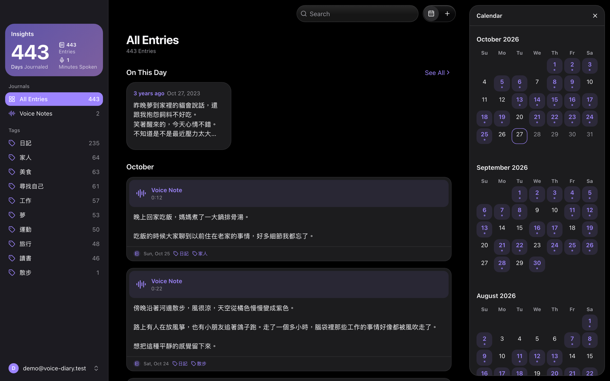
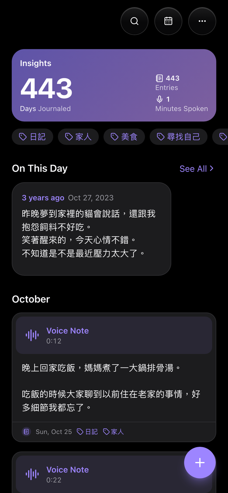
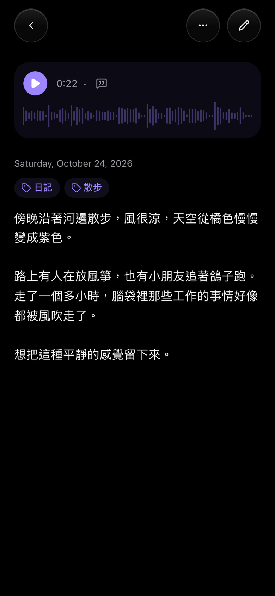

# Voice Diary

A self-hosted diary. Write each entry as text, record voice notes, or do both; every voice note is transcribed to text automatically.

You run it on your own accounts: the app on your Cloudflare Worker, entries in your Supabase database, audio in your R2 bucket. No one else hosts your diary, and only the emails you list can sign in. The one outside service is OpenAI, which receives each voice note to transcribe it.



<p align="center">
  
  &nbsp;&nbsp;
  
</p>

- **TanStack Start** (file routes in `src/routes`, server functions in `src/server`, a session middleware in `src/start.ts`) with TanStack Query for the pages' data, built by Vite and run as a Cloudflare Worker
- **Supabase**: Google sign-in plus Postgres, with row-level security so each user sees only their own entries
- **Cloudflare R2**: audio files, uploaded straight from the browser through presigned URLs
- **OpenAI `gpt-transcribe`**: speech-to-text

## Host your own

1. Create a Supabase project, an R2 bucket, an OpenAI API key and a Google OAuth client (see [Production](#production-cloudflare-workers)).
2. Add your email to the sign-in lists (see [Who can sign in](#who-can-sign-in)).
3. Store the values from `.env.example` as Worker secrets and run `pnpm run deploy`.
4. Optionally bring your old diary along (see [Importing from Journey](#importing-from-journey)) and add the app to your phone's home screen (see [On a phone](#on-a-phone)).

## How a voice note is saved

1. The browser records with `MediaRecorder` (WebM/Opus on Chrome and Firefox, MP4/AAC on Safari). When recording stops, the voice note shows up right away, playing from the local audio; the steps below run in the background.
2. `createRecordingUpload` checks that you own the entry and returns a presigned PUT URL that lasts 5 minutes.
3. The browser uploads the audio straight to R2.
4. `saveRecording` checks the object's size (25 MB max) and inserts a `recordings` row.
5. `transcribeRecording` downloads the audio, transcribes it, stores the transcript and adds the text to the end of the entry. The editor shows the transcript in the voice note and adds the text to the body in the same render.
6. If transcription fails, the recording is kept and its menu offers **Add Text to Entry** to try again.

## Environments

Only the database is separate between local development and production. R2 and OpenAI are shared:

| Service               | Local development                     | Production                     |
| --------------------- | ------------------------------------- | ------------------------------ |
| Supabase              | Supabase in Docker (`supabase start`) | Hosted project on supabase.com |
| Cloudflare R2         | The `voice-diary` bucket              | Same bucket                    |
| OpenAI                | One API key                           | Same key                       |
| Where the values live | `.env.local` on your machine          | The Worker's secrets           |

- `.env.local` is for local development only. Git ignores it, along with every `.env*` file except `.env.example`.
- Production values are never kept in a file in this repository. Enter them in the host's settings.
- Local and production recordings don't mix in the shared bucket: object keys start with the user's id (`<user-id>/<entry-id>/...`), and the local and hosted databases give the same Google account different ids.
- `supabase db reset` wipes the local database but not R2. The recordings it leaves behind stay under the old local user's id; delete that folder in the R2 dashboard if you want the space back.

## Local development

Requires Docker, the [Supabase CLI](https://supabase.com/docs/guides/cli) and pnpm.

### 1. Supabase in Docker

```bash
supabase start            # starts Postgres, Auth and Studio; applies supabase/migrations
supabase status           # shows the API URL and publishable key for .env.local
```

- Google sign-in needs an OAuth client (see **Google sign-in** below). Put its ID and secret in `supabase/.env`, using `supabase/.env.example` as the template, then restart with `supabase stop && supabase start`.
- Sign-ups are limited to listed emails here too (see **Who can sign in** below). Add yours in Studio's SQL editor, or the first Google sign-in is rejected with "This diary is private.":

  ```sql
  insert into public.allowed_emails (email) values ('you@gmail.com');
  ```

- Studio (a database GUI) runs at http://127.0.0.1:54323.
- To fill the local diary with invented entries (for demos and screenshots), sign in once, then run `SUPABASE_SECRET_KEY=<secret key from supabase status> pnpm seed --email you@gmail.com --apply`. Add `--voice 2` to read the two most recent entries aloud with OpenAI text-to-speech and attach them as voice notes, uploaded to R2. It replaces every entry of that account, audio included, and refuses to run against anything but the local database.
- To apply a new migration and keep local data, run `supabase migration up --local`. To rebuild from scratch, run `supabase db reset`. This wipes local data.
- Analytics is disabled in `supabase/config.toml` because its container runs out of memory on Docker Desktop's default limits.

### 2. Cloudflare R2 and OpenAI

Set up once, shared with production: see **Cloudflare R2** and **OpenAI** below.

### 3. `.env.local`

```bash
cp .env.example .env.local
```

Fill it in: `SUPABASE_URL` and `SUPABASE_PUBLISHABLE_KEY` from `supabase status`, the R2 and OpenAI values (the same ones production uses), and `ALLOWED_EMAILS` with the same emails as the local `allowed_emails` table. Then run:

```bash
pnpm install
pnpm dev
```

Linting and formatting use the Oxc toolchain: `pnpm lint` runs oxlint (`.oxlintrc.json`), `pnpm fmt` formats with oxfmt (`.oxfmtrc.json`, which also sorts Tailwind classes) and `pnpm fmt:check` reports unformatted files. Unit tests use Vitest with React Testing Library, next to the code they cover (`*.test.ts[x]`): `pnpm test` watches, `pnpm test --run` runs once.

The dev server runs at **https://localhost:3443**. `vite-plugin-mkcert` creates a locally trusted certificate with mkcert (microphone access needs HTTPS). The first run may ask for your macOS password to trust mkcert's root certificate. The dev server runs the server code in workerd, the Workers runtime, which reads `.env.local` too. `pnpm dev` and `pnpm build` first draw the icons and launch images into `public/` (`scripts/app-images.tsx`). `pnpm build` writes the Worker to `dist/`, and `pnpm preview` runs that build locally.

## Cloudflare R2

One private bucket serves both local development and production. In the Cloudflare dashboard, open **R2 Object Storage**:

1. **Create bucket** named `voice-diary`. Keep it private (no public access).
2. On the R2 **Overview** page, under **Account Details**, select **Manage** next to **API Tokens**. Create an **Account API token** with permission **Object Read & Write**, scoped to the `voice-diary` bucket. Copy the **Access Key ID** and **Secret Access Key** right away; the secret is shown only once. The **Account ID** is also under **Account Details**, and it is the subdomain of the S3 endpoint shown with the token (`https://<ACCOUNT_ID>.r2.cloudflarestorage.com`).
3. In the bucket's **Settings → CORS policy**, allow the local dev server and your production domain:

```json
[
  {
    "AllowedOrigins": ["https://localhost:3443", "https://your-domain.com"],
    "AllowedMethods": ["PUT", "GET"],
    "AllowedHeaders": ["Content-Type"],
    "MaxAgeSeconds": 3600
  }
]
```

## OpenAI

Create an API key at [OpenAI → API keys](https://platform.openai.com/api-keys). It is used for speech-to-text, by both local development and production.

## Google sign-in

1. In [Google Cloud Console → APIs & Services → Credentials](https://console.cloud.google.com/apis/credentials), configure the OAuth consent screen, then create an **OAuth client ID** of type **Web application**.
2. Under **Authorized redirect URIs**, add Supabase's callback, not the app's:
   - local: `http://127.0.0.1:54321/auth/v1/callback`
   - hosted: `https://<project-ref>.supabase.co/auth/v1/callback`
3. Local: copy the client ID and secret into `supabase/.env`. Hosted: paste them into Supabase → Authentication → Sign In / Providers → Google.
4. A new consent screen is in **Testing**, where Google only lets listed accounts sign in. Under **Audience → Test users**, add every Google account that will use the diary, locally or in production.

The flow: **Continue with Google** → Supabase → Google → Supabase → `/auth/callback` in this app, which exchanges the one-time code for a session cookie.

## Who can sign in

The diary is private; three lists decide who gets in, and each must include your Google account:

| List                                  | What it does                                                                                       |
| ------------------------------------- | -------------------------------------------------------------------------------------------------- |
| Google OAuth **Test users**           | Google refuses other accounts while the consent screen is in Testing                               |
| `public.allowed_emails` table         | The **Before User Created** hook (`public.restrict_signups`) rejects sign-ups from any other email |
| `ALLOWED_EMAILS` environment variable | The app signs out any account that is not listed, even one that already exists                     |

The table and the variable are kept per environment (local and production), so a personal email never lands in this repository.

## Production (Cloudflare Workers)

The app runs as a Cloudflare Worker, configured in `wrangler.jsonc`: the Worker serves the pages and server functions, and the built files in `dist/client` (scripts, styles, icons, launch images) are served as static assets without reaching it. The Worker is placed in Tokyo (`aws:ap-northeast-1`), next to the hosted Supabase project, since a page makes several database calls one after another.

### 1. Supabase

1. Create a project at supabase.com, in Tokyo (or change the Worker's `placement` to match).
2. Apply the migrations from this repository:

   ```bash
   supabase login
   supabase link --project-ref <project-ref>
   supabase db push
   ```

3. Add the emails allowed to sign up: `insert into public.allowed_emails (email) values ('you@gmail.com');`
4. Under **Authentication → Hooks**, add a **Before User Created** hook of type **Postgres**, using the function `public.restrict_signups`. Sign-ups from any other email are then rejected before an account is created.
5. Enable Google under **Authentication → Sign In / Providers** (see **Google sign-in**). The app only uses Google, so leave the email provider's sign-up off.

### 2. The Worker

Sign in once with `pnpm dlx wrangler login`. Store every variable from `.env.example` as a Worker secret, with production values, one at a time (each command asks for the value):

```bash
pnpm dlx wrangler secret put SUPABASE_URL
```

The hosted Supabase URL and publishable key are under **Project Settings → API Keys** in Supabase; `ALLOWED_EMAILS` should list the same emails as `public.allowed_emails`. Then deploy:

```bash
pnpm run deploy
```

Each deploy builds the app and uploads it. Secrets stay with the Worker between deploys.

### 3. The app's URL

Once the first deploy gives the app its URL (e.g. `https://voice-diary.<your-subdomain>.workers.dev`):

1. In Supabase, under **Authentication → URL Configuration**, set the Site URL to it and add `<app URL>/**` to **Redirect URLs**.
2. Add it to the R2 bucket's CORS origins (see **Cloudflare R2**), so browsers can upload voice notes.

### On a phone

The app ships a web app manifest, so it can live on the home screen and open full screen, without the browser's address bar. On iPhone, open the app's URL in Safari (or Chrome), choose **Share → Add to Home Screen**, and keep **Open as Web App** on. The home screen app keeps its own cookies, so sign in once more inside it. iOS saves the launch image (the icon shown while the app opens) at the moment you add it, for the light or dark mode the phone is in then, so let the page finish loading for a few seconds before tapping **Add**, and add it again if you later want the other mode's image.

## Importing from Journey

`scripts/import-journey.mts` copies entries from a [Journey](https://journey.cloud) export: each entry's text, date and tags. Photos, voice notes, places, weather and moods are left out.

1. Export from the Journey app (Mac or iPhone): **Settings → Data & Cloud Services →** your sync service **→ Export/Backup**, and unzip it. Journey on the web can't export entries synced with Google Drive.
2. Sign in to the diary once with the account to import into, so it exists.
3. Check what would be imported. This writes nothing:

   ```bash
   pnpm import:journey <folder of .json files, or one merged .json> --email you@gmail.com
   ```

4. Import, with the target project's URL and secret key (locally, both from `supabase status`; hosted, under **Project Settings → API Keys**):

   ```bash
   SUPABASE_URL=… SUPABASE_SECRET_KEY=… pnpm import:journey <export> --email you@gmail.com --apply
   ```

The key only opens a session for that account; the entries are written as that user, through row-level security. Rich text becomes plain text with blank lines between paragraphs, and each entry is dated in the time zone it was written in. Every Journey entry maps to the same diary entry, so running the import again skips what is already there.
