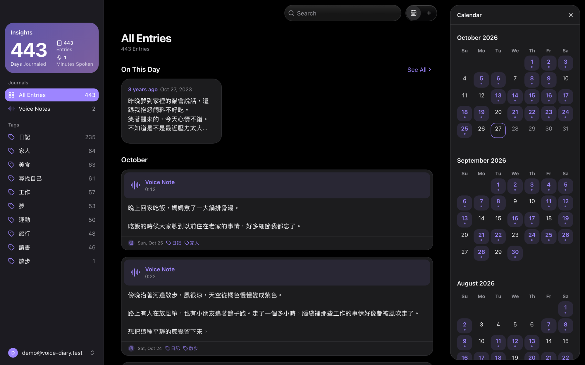
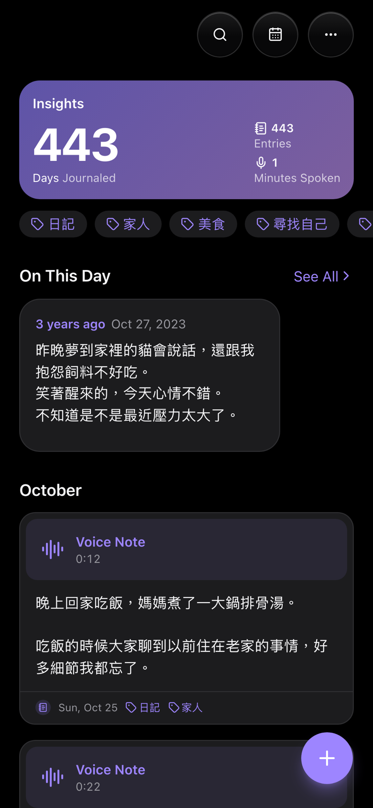
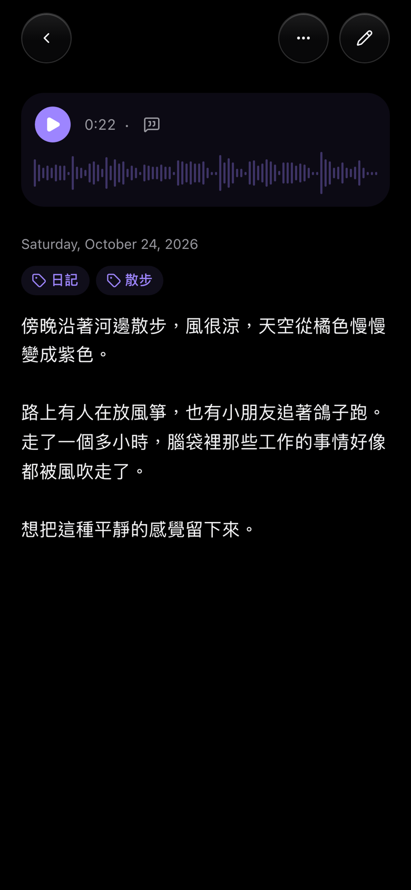

# Voice Diary

A self-hosted diary. Write each entry as text, record voice notes, or both; voice notes are transcribed automatically.

It runs on your own accounts: the app on a Cloudflare Worker, entries in Supabase, audio in R2. Only the emails you list can sign in. The one outside service is OpenAI, which transcribes the voice notes.



<p align="center">
  
  &nbsp;&nbsp;
  
</p>

- **TanStack Start** (routes in `src/routes`, server functions in `src/server`, session middleware in `src/start.ts`) with TanStack Query, built by Vite and run as a Cloudflare Worker
- **Supabase**: sign-in and Postgres, with row-level security so each user sees only their own entries
- **Cloudflare R2**: audio, stored and served through the Worker's `RECORDINGS` binding
- **OpenAI `gpt-transcribe`**: speech-to-text

## Try it locally

With Docker running and pnpm installed:

```bash
pnpm install
pnpm bootstrap
pnpm dev
```

Open https://localhost:3443 and sign in as `demo@voice-diary.test`, a diary of invented entries. The sign-in link arrives in Mailpit at http://127.0.0.1:54324. No Cloudflare, Google or OpenAI account is needed.

`pnpm bootstrap` starts Supabase in Docker (applying `supabase/migrations` and `supabase/seed.sql`), writes `.env.local` unless it exists, and fills the demo diary. Run it again to reset that diary.

## Local development

- **Transcription.** Set `OPENAI_API_KEY` in `.env.local`, or run the first bootstrap as `OPENAI_API_KEY=sk-... pnpm bootstrap`. Without it, voice notes are saved but not transcribed; each one's menu offers **Add Text to Entry** once a key is set.
- **Your own email.** Add it to both sign-in lists (see [Who can sign in](#who-can-sign-in)): `pnpm supabase db query --local "insert into public.allowed_emails values ('you@gmail.com')"`, and `ALLOWED_EMAILS` in `.env.local`, comma-separated.
- **Fake entries.** `pnpm seed --email you@gmail.com --apply` replaces a local account's entries with invented ones. Add `--voice 2` to attach spoken voice notes to the two newest (needs an OpenAI key). It refuses to run against anything but the local database.
- **Migrations.** `pnpm supabase migration up --local` applies new ones and keeps data. `pnpm supabase db reset` then `pnpm bootstrap` rebuilds from scratch. A browser signed in before a reset shows an empty diary until you sign out and back in: every local Supabase signs sessions with the same key, so the old session still passes the check, but its account is gone.
- **Audio** goes to a local stand-in for R2 under `.wrangler/state`; delete it to clear audio, since a database reset leaves it.
- **HTTPS.** The dev server uses a certificate from mkcert (the microphone needs HTTPS); the first run may ask for your macOS password to trust it.
- Studio, a database GUI, runs at http://127.0.0.1:54323. Supabase analytics is off in `config.toml` because it runs out of memory on Docker Desktop's defaults.

`.env.local` is for local development only and git ignores it. Production values live in the Worker's secrets, never in a file here.

| Command                  | What it does                                     |
| ------------------------ | ------------------------------------------------ |
| `pnpm test`              | Vitest with React Testing Library (`--run` once) |
| `pnpm lint`              | oxlint                                           |
| `pnpm fmt` / `fmt:check` | oxfmt, which also sorts Tailwind classes         |
| `pnpm build`             | Builds the Worker into `dist/`                   |
| `pnpm preview`           | Runs that build locally                          |

### Google sign-in locally

Local sign-in is an emailed link by default. To try Google instead:

1. In [Google Cloud Console → Credentials](https://console.cloud.google.com/apis/credentials), set up the OAuth consent screen and create a **Web application** OAuth client. Under **Authorized redirect URIs**, add local Supabase's callback, not the app's: `http://127.0.0.1:54321/auth/v1/callback`. Under **Audience → Test users**, add your Google account.
2. Create `supabase/.env` from its template, then fill in the client's ID and secret. Git ignores it, and its `SUPABASE_AUTH_EXTERNAL_GOOGLE_ENABLED=true` turns Google on over `enabled = false` in `supabase/config.toml`, so nothing tracked changes.

   ```bash
   cp supabase/.env.example supabase/.env
   ```

3. Add your Google account's email to both local sign-in lists (see **Your own email** above).
4. Restart Supabase so it reads the new settings:

   ```bash
   pnpm supabase stop && pnpm supabase start
   ```

The login page now shows **Continue with Google** under the email form. If Google answers `redirect_uri_mismatch`, the URI in step 1 is missing; if it says access is blocked, the account isn't a test user.

## How a voice note is saved

1. The browser records with `MediaRecorder` and shows the voice note right away from the local audio; the rest runs in the background.
2. It uploads the audio to `/audio/<key>` (`src/routes/audio/$.ts`), which checks the key starts with your user id and writes it to R2. Voice notes play back from the same URL.
3. `saveRecording` checks the size (25 MB max) and inserts a `recordings` row, then `transcribeRecording` transcribes it and appends the text to the entry. If that fails, the recording is kept and its menu offers **Add Text to Entry**.

## Who can sign in

Three lists must each include your account:

| List                                  | What it does                                                                |
| ------------------------------------- | --------------------------------------------------------------------------- |
| Google OAuth **Test users**           | Google refuses other accounts while the consent screen is in Testing        |
| `public.allowed_emails` table         | The **Before User Created** hook (`public.restrict_signups`) rejects others |
| `ALLOWED_EMAILS` environment variable | The app signs out any account not listed, even an existing one              |

The table and the variable are kept per environment, so no personal email lands in this repository. Locally, sign-in is an emailed link, so Google's test users apply only if you turn Google on there.

## Host your own

The Worker (`wrangler.jsonc`) serves the pages and server functions; built assets in `dist/client` are served without reaching it. It's placed in Tokyo (`aws:ap-northeast-1`), next to the Supabase project, because a page makes several database calls in a row.

1. **Supabase.** Create a project in Tokyo (or change the Worker's `placement`), then apply the migrations:

   ```bash
   pnpm supabase login
   pnpm supabase link --project-ref <project-ref>
   pnpm supabase db push
   ```

   Add your email with `insert into public.allowed_emails (email) values ('you@gmail.com');`, and under **Authentication → Hooks** add a **Before User Created** hook of type Postgres using `public.restrict_signups`.

2. **Google sign-in.** In [Google Cloud Console → Credentials](https://console.cloud.google.com/apis/credentials), set up the OAuth consent screen and create a **Web application** OAuth client. Its redirect URI is Supabase's callback, `https://<project-ref>.supabase.co/auth/v1/callback` (locally `http://127.0.0.1:54321/auth/v1/callback`). Paste the ID and secret into Supabase → **Authentication → Sign In / Providers → Google**, leave email sign-up off, and add every account that will use the diary under **Audience → Test users**.

3. **OpenAI.** Create a key at [OpenAI → API keys](https://platform.openai.com/api-keys).

4. **The Worker.** Sign in with `pnpm dlx wrangler login`, store each variable in `.env.example` as a secret (`pnpm dlx wrangler secret put SUPABASE_URL`, and so on; Supabase's are under **Project Settings → API Keys**), then deploy:

   ```bash
   pnpm run deploy
   ```

   Audio goes to the R2 bucket named in `wrangler.jsonc` (`voice-diary-audio`). Create it in Asia-Pacific before the first deploy, since the deploy would otherwise create it with no location hint and R2 honours the hint only the first time a name is used:

   ```bash
   pnpm dlx wrangler r2 bucket create voice-diary-audio --location apac
   ```

   The Worker uses it through the binding, so there are no R2 tokens or CORS rules to set.

5. **The app's URL.** In Supabase under **Authentication → URL Configuration**, set the Site URL to the deployed URL and add `<app URL>/**` to Redirect URLs.

**On a phone**, open the app in Safari, choose **Share → Add to Home Screen** and keep **Open as Web App** on, then sign in again inside it. iOS saves the launch image for the light or dark mode the phone is in when you add it, so let the page load for a few seconds first.

## Importing from Journey

`pnpm import:journey` copies the text, date and tags of each entry from a [Journey](https://journey.cloud) export (photos, voice notes, places, weather and moods are left out).

1. In the Journey app (Mac or iPhone), go to **Settings → Data & Cloud Services →** your sync service **→ Export/Backup** and unzip it.
2. Sign in to the diary once so the account exists.
3. Preview, then import with the target project's URL and secret key (locally from `pnpm supabase status`):

   ```bash
   pnpm import:journey <export folder or merged .json> --email you@gmail.com
   SUPABASE_URL=… SUPABASE_SECRET_KEY=… pnpm import:journey <export> --email you@gmail.com --apply
   ```

Entries are written as that user through row-level security, dated in the time zone they were written in. Running it again skips entries already imported.
